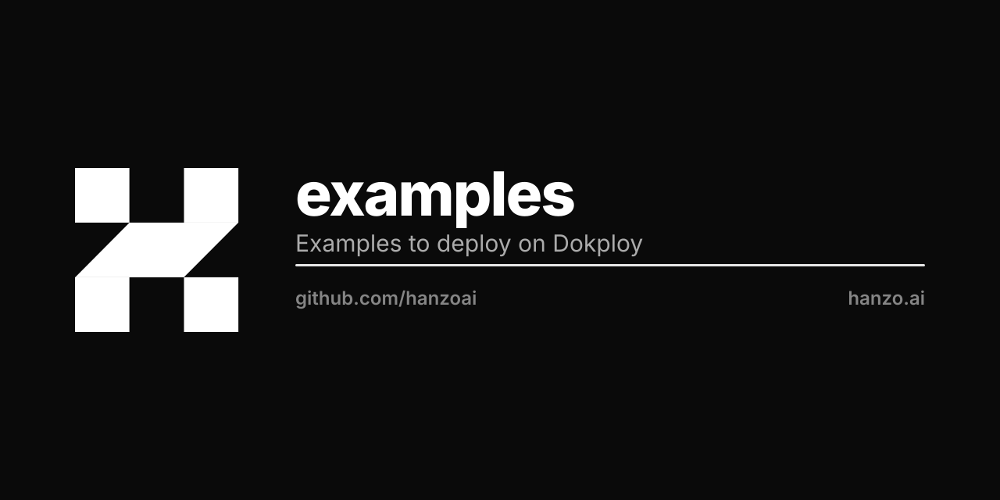

# Dokploy Examples

 

---
This repository contains examples of how to deploy applications using Dokploy.
- [x] 11ty
- [x] Astro
- [x] Astro SSR
- [x] Django
- [x] Flask
- [x] Go Fiber
- [x] Lit
- [x] NestJS
- [x] NextJS
- [x] Nuxt
- [x] Preact
- [x] Qwik
- [x] Remix
- [x] SolidJS
- [x] Svelte
- [x] T3 App
- [x] Turborepo
- [x] HTML
- [x] Tanstack
- [x] Vite
- [x] VueJS
---

